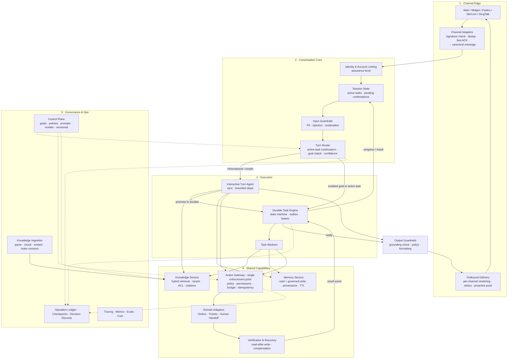
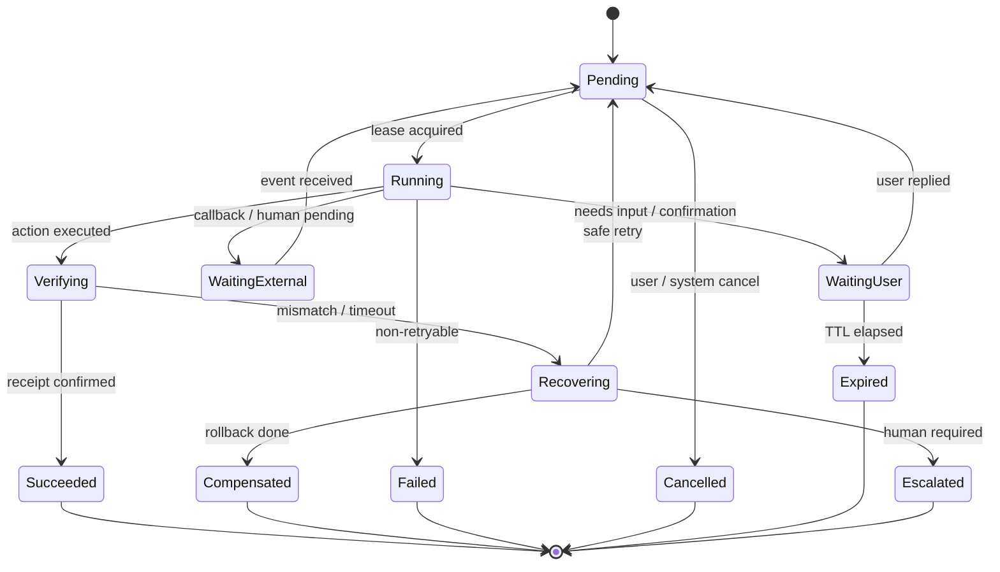
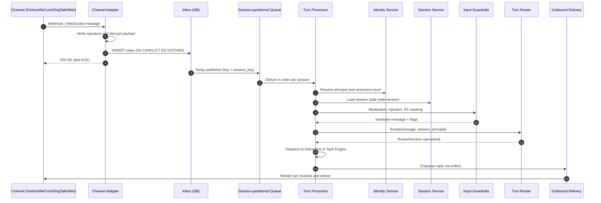
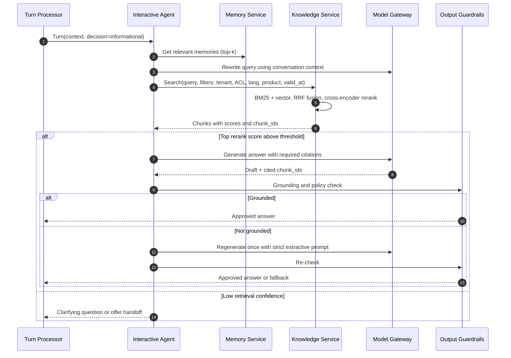
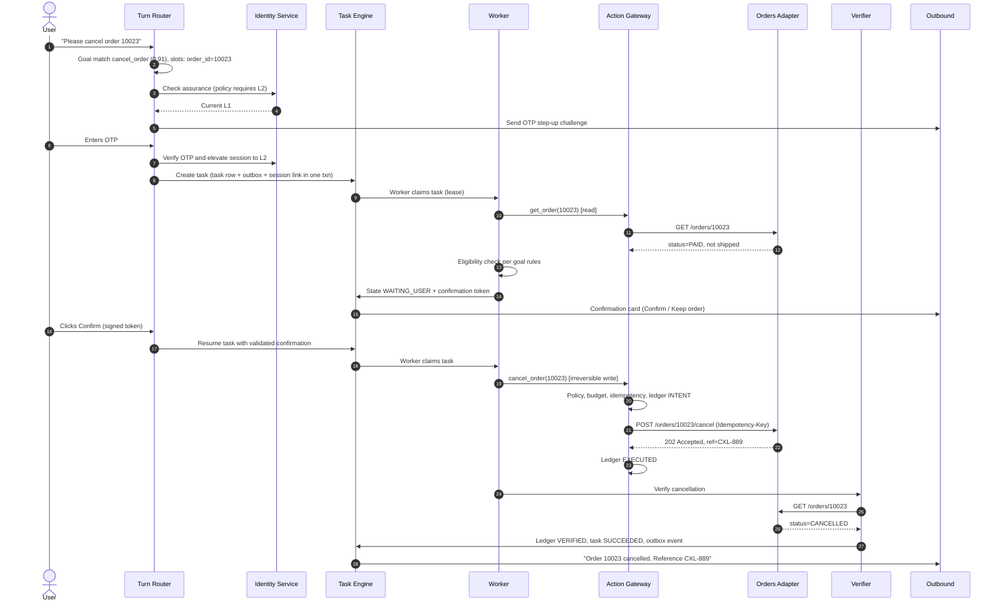
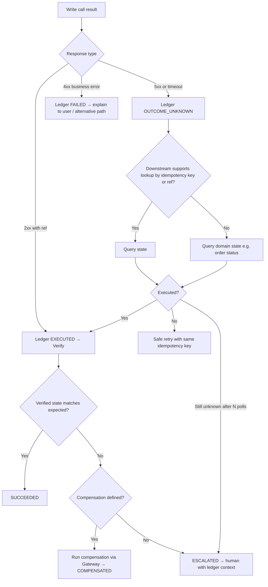

# Optimized Architecture: Multi-Channel AI Service Agent

Your diagram leaves some behavior open, so I've assumed the most common reading. The system is a customer-service and operations agent. Goal Intake decides whether a message becomes a long-running **task**, which is saved to the database and run by background workers. If it doesn't, the message is answered right away by the **conversational pipeline**, using document retrieval (RAG) and the older tools. If any of that is wrong, the recommendations still mostly apply, but tell me and I'll adjust them.

---

## 1. What the current design gets right

- Long-running goals are kept separate from plain question-and-answer, and tasks are saved to the database rather than held in memory.
- Execution is governed: a policy registry, permissions and budgets apply before anything runs.
- It checks receipts after acting instead of trusting the tool call.
- It keeps an audit trail of checkpoints, operations and decisions.
- Answers are grounded in sources with citations.

Those are good foundations. The problems are mainly about **consistency, missing feedback loops and duplicated paths**.

---

## 2. Problems with the current design

| # | Issue | Risk |
|---|---|---|
| 1 | **Two separate ways to execute actions.** The "Legacy" box (tools, tickets, human handoff) and the task path (orders, tickets, human handoff) do overlapping things. | The Legacy path **skips** the Policy Registry, permissions, budget, verification and the ledger. Anyone who wants to get around governance can phrase a request so it isn't routed to a task. |
| 2 | **Routing is a simple yes/no.** Intake only asks "does this match an enabled goal?" | It doesn't handle a task that's already running ("actually, cancel that"), uncertain matches, switching goals mid-task, or getting a user's identity checked before a sensitive goal. |
| 3 | **The result never gets back to the user.** "Session Result Write-back" has no arrow back to the session or channels. | A task can finish while the user hears nothing. There is no proactive push on Feishu, WeCom or DingTalk. |
| 4 | **Memory is one-way and only feeds the worker.** | Direct answers don't use preferences. Nothing shows who writes to memory, how conflicting facts are resolved, or when facts expire or need consent. |
| 5 | **The audit trail only covers tasks.** | There's no audit or trace for direct answers, which are probably most of your traffic. |
| 6 | **RAG and tools sit side by side under Pipeline.** | It's unclear how answers combine tool results with retrieved documents, and whether tool output gets checked against sources. |
| 7 | **No input/output safety checks.** | Prompt injection (especially through retrieved documents and tool output), leaked personal data, and off-policy answers. |
| 8 | **No path for loading knowledge into RAG.** | Stale documents, no index versioning, and no permission filtering on retrieval. |
| 9 | **No central configuration or monitoring layer.** | Goals, policies, prompts and models can't be versioned, rolled out gradually, or evaluated. |
| 10 | **"DB Dispatch" is underspecified.** | Without leases, idempotency keys and an outbox, you risk running the same action twice (for example two refunds) or tasks getting stuck. |

---

## 3. Target architecture



**The main structural changes:**
1. **One Action Gateway for all actions.** The Legacy branch is removed. Direct answers and background tasks both reach orders, tickets and handoff through the same policy, permission, budget and idempotency checks.
2. **Two ways to run, one set of capabilities.** "Interactive" (answered immediately, step-limited) and "Durable" (resumable, can wait days) differ only in *how* they run. Both use the same knowledge, memory and actions.
3. **The loop is closed.** Verification sends a result event to the task engine, which updates the session and pushes the result out through the channels.
4. **Safety checks at both ends**, with grounding verification before anything is sent.
5. **Governance covers everything**, not just tasks.

---

## 4. Component-by-component recommendations

### 4.1 Channel Edge
- **Canonical message format:** `{tenant_id, channel, channel_user_id, conversation_id, message_id, content_parts[], attachments[], received_at, raw_ref}`. Nothing after the adapters should contain channel-specific code.
- **Acknowledge fast, process later.** Feishu, WeCom and DingTalk callbacks expect a quick response and will **resend** if they don't get one. Check the signature, save to an inbox table keyed on `(channel, message_id)` to drop duplicates, return 200 straight away, and process asynchronously.
- **Outbound Delivery as its own service:** one renderer per channel (Feishu cards, WeCom template cards, DingTalk ActionCards, markdown for Web), message splitting for length limits, retries with backoff, and per-tenant rate limits for each channel API.
- **Proactive push:** needed for task results and "waiting for your confirmation" prompts. Respect each channel's rules on proactive messages.
- **Streaming** for Web and the widget (SSE or WebSocket). Show the user something within about 1 second.

### 4.2 Identity and Session
- **Account linking:** map Feishu `union_id`/`open_id`, WeCom `userid`/`external_userid`, DingTalk `unionid` and widget visitor IDs to one `principal_id`.
- **Identity assurance levels** (e.g. L0 anonymous, L1 channel-verified, L2 OTP or logged in). Policies refer to these levels. For example, `cancel_order` requires L2. The router can then trigger a verification step instead of refusing.
- **Session state** holds active task IDs, pending confirmations or clarifications, the language, and a rolling summary of the conversation. Keep hot state in Redis and write it through to the database. Use optimistic locking (a version column) so two near-simultaneous messages can't corrupt it.
- **Process each conversation in order:** use a per-session lock or queue partition so messages from one user are handled one at a time, while different users are still handled in parallel.

### 4.3 Turn Router (replaces Goal Intake)
Route in a fixed order of precedence:

| Priority | Condition | Route |
|---|---|---|
| 1 | Control intent ("cancel", "stop", "speak to a human") | Control handler: cancel the task or hand off right away |
| 2 | Session has a task in `WAITING_USER` and the message answers it | Resume that task |
| 3 | Session has an active task, but the message is a new topic | Answer interactively without dropping the task, or ask "pause your refund request?" |
| 4 | Matches an enabled goal with confidence ≥ high threshold **and** identity meets the policy | Create a durable task |
| 5 | Goal match in the medium confidence band | Ask a short clarifying question with choices (quick-reply buttons) |
| 6 | Goal matched but identity is too weak | Verification sub-flow, then create the task |
| 7 | Informational question | Interactive agent with Knowledge |
| 8 | Out of scope or not allowed | Refuse, offering a human if available |

- Combine three things: deterministic rules (keywords, button payloads), a small fast classifier, and an LLM only as a fallback. This cuts latency and cost.
- Record **every routing decision** (inputs, scores, rule hit, goal and policy version) as a Decision Record so misroutes can be replayed and evaluated.
- Allow an **interactive turn to be promoted to a durable task** when it finds it needs a multi-step or long-running action. This means the router doesn't have to be perfect.

### 4.4 Action Gateway (single enforcement point)
Every side effect goes through this pipeline:

1. **Look up the capability** in a registry: name, input schema, side-effect class (read, reversible write, irreversible write), required identity level, cost, and compensating action.
2. **Check policy** with a policy engine (e.g. OPA/Cedar, or a versioned in-house registry). Inputs: principal, tenant, goal, amount, and risk score.
3. **Check the budget**, with layered limits: tokens and LLM calls per turn/task, tool calls per task, **business limits** (e.g. refund ≤ €50 without human approval, at most N refunds per user per month), and wall-clock time.
4. **Confirmation gate:** irreversible writes need explicit user confirmation (a button) or human approval, depending on policy.
5. **Idempotency:** `idempotency_key = hash(task_id, step, capability, normalized_args)`. Pass it to downstream APIs where they support it, and check the ledger where they don't.
6. **Write-ahead to the ledger:** record `INTENT` **before** calling the downstream system, then `EXECUTED` or `FAILED`, then `VERIFIED` or `COMPENSATED`.
7. **Circuit breakers and timeouts** for each domain adapter.

The model only ever sees **capabilities it is allowed to use** in the current context. Filtering the tool list is your first line of defense; the policy check is the second.

### 4.5 Durable Task Engine

**State machine:**



**Dispatching from the database without double execution (PostgreSQL example):**

```sql
CREATE TABLE tasks (
  id               UUID PRIMARY KEY,
  tenant_id        UUID NOT NULL,
  session_id       UUID NOT NULL,
  principal_id     UUID NOT NULL,
  goal_key         TEXT NOT NULL,
  goal_version     INT  NOT NULL,
  policy_version   INT  NOT NULL,
  state            TEXT NOT NULL,
  current_step     INT  NOT NULL DEFAULT 0,
  checkpoint       JSONB,              -- minimal resumable state, not full transcript
  budget_remaining JSONB,
  attempt          INT  NOT NULL DEFAULT 0,
  next_run_at      TIMESTAMPTZ NOT NULL DEFAULT now(),
  lease_owner      TEXT,
  lease_expires_at TIMESTAMPTZ,
  deadline_at      TIMESTAMPTZ,
  version          INT  NOT NULL DEFAULT 0,   -- optimistic locking
  created_at       TIMESTAMPTZ DEFAULT now(),
  updated_at       TIMESTAMPTZ DEFAULT now()
);
CREATE INDEX ON tasks (state, next_run_at) WHERE state = 'PENDING';

-- Claim work
UPDATE tasks SET state='RUNNING', lease_owner=$1,
       lease_expires_at=now()+interval '60 s', attempt=attempt+1
WHERE id IN (
  SELECT id FROM tasks
  WHERE state='PENDING' AND next_run_at <= now()
  ORDER BY next_run_at
  FOR UPDATE SKIP LOCKED
  LIMIT $2)
RETURNING *;
```

- **Lease heartbeats.** A reaper puts tasks back to `PENDING` when their lease expires. This is safe because of idempotency keys and the write-ahead ledger.
- **Transactional outbox.** State changes and the events they produce (notify the user, update the session, call a webhook) are written in the same transaction. A relay then publishes them, so you never end up with "task finished but user not told".
- **Retries** use exponential backoff with jitter. After N attempts, move the task to a dead-letter state with an alert.
- **Fairness:** per-tenant concurrency limits so one tenant can't starve the others. Use priority lanes (e.g. interactive confirmations ahead of batch work).
- **Long waits** (human handoff, external callbacks) **don't hold a worker**. The task is parked in `WAITING_EXTERNAL` and woken by an event.
- **When to move off the database:** once you pass roughly a few hundred task steps per second, or need complex workflows, consider Temporal, or Postgres plus a queue like NATS/Kafka. The state model above carries over.

### 4.6 Verification and Recovery
- **Read after write:** after `create_ticket`, fetch the ticket by its external ID and compare the fields. After `refund`, check the payment status.
- **Handle async systems:** poll with backoff until the deadline, or subscribe to downstream webhooks.
- **Compensation is defined per capability** in the registry (cancel the order, then restore the voucher). If there is no safe compensation, escalate to a human with full context.
- **Write the result back** as an outbox event. Session Service updates state, and Outbound renders a user-friendly message with the reference number.

### 4.7 Knowledge Service (RAG)
- **Ingestion pipeline (new):** connectors → parsing (including tables and PDFs) → structure-aware chunking with titles and breadcrumbs → embeddings → **versioned indexes** with atomic alias swaps. Re-index incrementally when a document changes.
- **Retrieval:** BM25 plus vectors, combined with reciprocal rank fusion, then a cross-encoder reranker. Filter by tenant, ACL, language, product and validity dates *before* ranking.
- **Query rewriting** using the conversation context, plus decomposition for multi-part questions.
- **Grounding contract:** the generator must cite chunk IDs, and the output guard checks that each claim is supported. If confidence is low, the agent should say "I'm not sure" and offer a handoff instead of making something up.
- **Treat retrieved text as untrusted data.** Delimit it, strip instructions from it, and never let it trigger actions directly.
- **Caching:** semantic cache for frequent FAQ answers, invalidated when the index version changes.

### 4.8 Memory Service
- **Read and write**, available to both execution modes.
- **Typed records:** `{principal_id, type: preference|fact|constraint, key, value, source (user_stated|inferred|system), confidence, evidence_ref, created_at, expires_at, consent_scope}`.
- **"Effective" value resolution:** explicit user statements beat inferred ones, newer beats older within the same source, and system-of-record data (e.g. the CRM address) beats conversation memory for business facts.
- **Governed writes:** an LLM proposes memories and a validator accepts them (schema, PII class, consent). Sensitive categories are never stored automatically.
- **User controls:** "what do you remember about me" and "forget this", to support GDPR access and erasure.
- **Retrieval budget:** inject only the top-k relevant memories into the prompt, not the whole profile.

### 4.9 Human Handoff
- A **handoff packet** goes to the agent: conversation summary, identity level, task state, actions attempted with ledger refs, suggested next step.
- Integrate with your agent desk (ticketing or live chat) and route by skill, language and SLA.
- **Return to the bot:** the human can resolve the case or hand it back, and the task resumes from its checkpoint.
- Track handoff rate per goal and reason. This is one of your best improvement signals.

### 4.10 Guardrails
- **Input:** prompt-injection detection, moderation, personal data detected and masked before logging, attachment scanning.
- **Output:** grounding check, policy check (no promises outside policy, e.g. "you'll get a full refund"), leak check (system prompt, other customers' data), and channel formatting.
- **Tool output** is sanitized before it re-enters the model's context.

### 4.11 Governance: ledger, checkpoints, decision records
- **Append-only** storage (no updates or deletes), with hash chaining for tamper evidence if you have compliance needs.
- **Records all routing decisions, policy decisions and actions**, from both execution modes.
- **Ledger entry:** `op_id, task_id|turn_id, step, capability, args_hash, idempotency_key, policy_decision, policy_version, decision_reason, actor (agent|user|human_agent), status, external_ref, latency_ms, cost, ts`.
- **Checkpoints** hold only the state needed to resume, not full transcripts. Store transcripts separately with retention rules.
- **Replay tooling:** rebuild any conversation or task from the ledger to debug it or run an eval.

### 4.12 Observability and evaluation
- **End-to-end tracing** (OpenTelemetry): one trace ID from channel ingress through router, LLM calls, retrieval, actions and outbound delivery.
- **Cost attribution** per tenant, goal, model and step.
- **Offline evals:** golden sets per goal (routing accuracy, task success, policy compliance) and per RAG domain (retrieval recall@k, faithfulness, citation correctness). These run in CI on every prompt, model or policy change.
- **Online evals:** sampled LLM-as-judge plus human review queues, and user feedback (thumbs, CSAT).
- **Dashboards and alerts:** stuck tasks, dead-letter growth, verification mismatch rate, channel delivery failures, and spikes in guardrail triggers.

### 4.13 Control plane
- **Versioned configuration** for goals, policies, prompts, capability registry, model routing and thresholds.
- **Staged rollout:** draft → shadow (evaluate without acting) → canary per tenant → general availability, with instant rollback.
- **Pin versions:** running tasks keep the goal and policy versions they started with. Don't switch them mid-task.
- **Per-tenant overrides:** enabled goals, limits, tone, languages, handoff hours.

### 4.14 Model gateway (cross-cutting)
- One gateway for all LLM and embedding calls, handling provider fallback, retries, rate limits, token accounting and response caching.
- **Tiered models:** a small or fast model for routing, classification and guards, and a stronger model for planning and complex answers.
- **Structured outputs** (JSON schema) for every tool call and router decision.

---

## 5. Non-functional targets

| Area | Recommendation |
|---|---|
| Latency | Router p95 < 300 ms. First token on Web/widget < 1.5 s. Fast ACK on IM webhooks < 1 s. |
| Reliability | At-least-once delivery plus idempotency, which effectively gives exactly-once side effects. No in-memory-only state. |
| Scalability | Stateless API, harness and workers scale horizontally. Partition by tenant and session. Read replicas for retrieval metadata. |
| Security | Least-privilege service credentials per domain adapter. Secrets in a vault. Encryption at rest and in transit. Tenant isolation enforced in queries (row-level security). |
| Privacy | Personal data masked in logs and traces, retention policies per data class, memory erasure. |
| Cost | Rule- or classifier-first routing, semantic cache, a context budget per step, and conversation summarization. |

---

## 6. Migration plan (no big-bang rewrite)

1. **Phase 1 – Close the safety gaps (2–4 weeks).** Put the Action Gateway in front of the *Legacy* tools without changing their behavior. Start logging both paths to the ledger. Add idempotency keys and the inbox-based dedup for channels.
2. **Phase 2 – Close the loop (2–3 weeks).** Add the outbox, the result → session → Outbound flow, and proactive push per channel. Add lease and reaper logic to DB dispatch.
3. **Phase 3 – Smarter routing (3–4 weeks).** Turn Router with active-task continuation, confidence bands and identity checks, recording a Decision Record for every route. Run it in **shadow mode** against the current Intake and compare.
4. **Phase 4 – Shared capabilities (4–6 weeks).** Make Memory read/write and available to the interactive path. Run Knowledge as a service with an ingestion pipeline, ACL filtering and a reranker. Add input and output guardrails.
5. **Phase 5 – Merge and retire (ongoing).** Move Legacy tools into the capability registry, delete the duplicate ticket and handoff code, and introduce the control plane and eval gates in CI.

---

## 7. KPIs to track

- **Containment / automation rate** per goal: resolved without a human.
- **Task success rate** and **verification mismatch rate**.
- **Routing accuracy**, measured against labeled samples.
- **Grounded answer rate** and **citation correctness**.
- **Policy violations blocked** at the gateway, which should trend toward zero once prompts and tool filtering improve.
- **Handoff rate and reasons**, plus **time to resolution** after handoff.
- **Cost per resolved conversation**, and **p95 latency** per channel.
- **Duplicate side effects**, with a target of 0.

---

## 8. Questions that would sharpen this further

1. "Harness" is  agent loop (planning and tool calling)


## 9. End-to-end flows

### 9.1 Inbound message lifecycle (applies to every message)



**Step by step:**

1. **Receive.** The adapter exposes one endpoint per channel and tenant, e.g. `/ingress/feishu/{tenant_id}`.
2. **Verify.** Use each channel's mechanism: the Feishu verification token or encrypt key, WeCom `msg_signature` plus AES decryption, DingTalk `timestamp` plus HMAC-SHA256 `sign`. If verification fails, return 401, increment `ingress_auth_failures_total`, and **do not** write to the inbox.
3. **Normalize** to a `CanonicalMessage` (§10.1). Keep the raw payload in object storage (`raw_ref`) for 7–30 days for debugging.
4. **Deduplicate.** `INSERT INTO inbox (...) ON CONFLICT (channel, channel_message_id) DO NOTHING`. If nothing was inserted, the message is a channel retry: return 200 and stop.
5. **ACK immediately**, staying within each channel's response window. Never call an LLM synchronously inside the webhook request.
6. **Relay.** A relay process reads unpublished inbox rows and publishes them with `partition_key = tenant_id:session_key`. This guarantees **one turn at a time per conversation**.
7. **Resolve identity.** Map `(channel, channel_user_id)` to `principal_id` and attach the `assurance_level` (L0–L2). If the user is new, create a principal at L0 or L1.
8. **Load the session** from Redis (falling back to Postgres) and keep `session.version` for optimistic locking.
9. **Input guardrails.** Moderation, prompt-injection score, and PII detection. Masked text goes to logs and the original is kept only in the encrypted transcript store.
10. **Route** (§9.3 and Part I §4.3). The decision is saved as a Decision Record *before* anything is dispatched.
11. **Dispatch** to the Interactive Turn Agent or the Durable Task Engine.
12. **Reply** through output guardrails, the outbox and Outbound Delivery.
13. **Commit the session:** `UPDATE sessions SET ..., version = version + 1 WHERE id = ? AND version = ?`. If no row is updated, reload and merge. This should be rare because of partition ordering.

**Acceptance criteria:**
- Replaying the same webhook 10 times produces exactly 1 turn.
- p95 ACK latency is under 300 ms.
- Two messages sent 50 ms apart in the same session are processed in order.

---

### 9.2 Interactive informational answer (RAG) with fallback ladder



**Step by step:**

1. **Build context:** session summary, the last N turns (default 6), top-k memories (default 5), and the tenant persona and language.
2. **Rewrite the query** so it stands alone, e.g. "And for the blue one?" becomes "Return policy for blue Model X jacket". Split it into sub-queries if it has several parts (at most 3).
3. **Filter before ranking:** `tenant_id`, document ACL groups for the principal, language, product line, `valid_from <= now() < valid_to`.
4. **Hybrid retrieval:** BM25 top 50 plus vector top 50, combined with reciprocal rank fusion (k=60), then rerank to the top 8.
5. **Confidence gate** (calibrate on your eval set; these are starting values):
   - top score ≥ 0.55: answer
   - between 0.35 and 0.55: answer with an explicit uncertainty note and offer to clarify
   - below 0.35: don't answer from the knowledge base. Ask a clarifying question, or offer a handoff after 2 failed attempts.
6. **Generate** with a contract: every factual sentence must reference a `chunk_id`, and the output is structured JSON `{answer_parts:[{text, citations[]}], followups[]}`.
7. **Grounding check:** a small NLI or LLM judge verifies each part against its cited chunks. Parts that aren't supported are removed. If more than 30% are removed, regenerate once in strict extractive mode.
8. **Policy check:** no commitments beyond policy (refund promises, legal claims), no system-prompt leakage, no other users' data.
9. **Render the citations** for the channel: footnote links on Web, a card with source buttons on Feishu, DingTalk and WeCom.
10. **Log** the `retrieval_trace` (query, filters, chunk IDs, scores, index version) to the trace and the Decision Record.

**Promotion rule:** if the agent sees during the turn that the user wants an action covered by an enabled goal, it emits `promote_to_task(goal_key, extracted_slots)` instead of calling the action directly.

---

### 9.3 Durable task: order cancellation with identity step-up and confirmation



**Step by step:**

1. **Goal match.** The router compares the message with enabled goals for the tenant and extracts slots using the goal's slot schema (§10.3). Missing required slots lead to a clarification ("Which order? You have 2 open orders:" followed by buttons).
2. **Identity step-up.** If `principal.assurance < goal.required_assurance`, run the verification sub-flow (OTP to the registered phone or email, or a login deep link for Web). Store the elevated assurance on the session with a TTL (e.g. 30 min).
3. **Create the task atomically**, in one transaction:
   - `INSERT INTO tasks (state='PENDING', goal_key, goal_version, policy_version, ...)`
   - `INSERT INTO outbox (event='task.created', ...)`
   - `UPDATE sessions SET active_task_ids = array_append(...)`
4. **Acknowledge to the user** straight away: "I'm checking order 10023…" This is the turn's reply, sent through the outbox.
5. **Worker claims** the task with `FOR UPDATE SKIP LOCKED` and gets a 60 s lease, renewed every 20 s by heartbeat.
6. **Read step.** `get_order` is a read capability: no confirmation needed, but it still goes through the gateway for policy, budget and tracing.
7. **Eligibility rules** are deterministic code or rules, not LLM judgement: `status in (PAID, PROCESSING)`, `not shipped`, `created_at > now() - 14d`. If ineligible, explain why and offer alternatives (return flow, handoff).
8. **Confirmation gate.** The worker saves a checkpoint, sets `WAITING_USER`, and issues a **signed confirmation token**: `HMAC(secret, task_id | step | args_hash | expires_at | nonce)`. The card shows exactly what will happen.
9. **User confirms.** The router (priority 2: active task waiting) validates the token. It must match the signature, not be expired, have an unused nonce, and have `args_hash` equal to the pending action. Then it moves the task to `PENDING`. Clicking twice is harmless because the nonce is consumed.
10. **Execute.** The gateway runs the full pipeline (Part I §4.4 and §15.2). The idempotency key is derived from `(task_id, step, capability, normalized_args)`.
11. **Verify.** Read the order back. If the downstream system is asynchronous, poll with backoff (1 s, 2 s, 4 s … up to the deadline, e.g. 5 min) or wait for its webhook while the task is in `WAITING_EXTERNAL`.
12. **Complete.** Set `SUCCEEDED`, write ledger `VERIFIED`, emit outbox `task.succeeded`, remove the task from `session.active_task_ids`, and notify the user with the reference.
13. **Memory side effect (optional):** propose a fact such as `last_cancellation_reason` only if the user stated one (§9.8).

**Acceptance criteria:**
- Killing the worker at any step never results in double cancellation.
- A replayed confirmation click is rejected.
- A confirmation token for a different order ID is rejected.

---

### 9.4 Message arrives while a task is active (interruption handling)

**Decision procedure in the router:**

1. If `session.active_task_ids` is empty, use normal routing.
2. Otherwise, classify the message's relation to the most recent active task:
   - **Control** (cancel, stop, "never mind", or a human request): go to step 3.
   - **Answer** to a pending question or confirmation: resume the task.
   - **Related modification** ("make it order 10024 instead"): resume the task with a `slot_update` event. The worker re-validates and re-confirms if the arguments changed.
   - **Unrelated:** answer interactively. The task stays parked, and the reply ends with a short reminder: "Your cancellation for order 10023 is still waiting for confirmation."
3. **Cancellation:**
   - Before any irreversible action: set `CANCELLED` and confirm to the user.
   - After an irreversible action was `EXECUTED`: look up the compensating capability in the registry. If one exists, ask for confirmation and run it. If not, tell the user it's too late and offer a handoff.
4. **Expiry:** tasks in `WAITING_USER` past their TTL (default 24 h, set per goal) move to `EXPIRED`. Send one optional reminder at 50% of the TTL.

---

### 9.5 Uncertain outcomes, verification failure and recovery

The most dangerous case is a **timeout on a write**. You don't know whether it happened.



**Rules:**
1. **Never retry a write blindly after a timeout.** Always resolve the state first.
2. Retries **reuse the same idempotency key**.
3. Compensation is itself a gateway action: policy-checked, written to the ledger, and verified.
4. Every escalation creates a handoff packet (§9.6) whose ledger excerpt shows exactly what was attempted.
5. Alert when `verification_mismatch_rate > 1%` for any capability over 15 min.

---

### 9.6 Human handoff and return to bot

**Triggers** (each configurable per tenant):
- the user explicitly asks
- policy requires approval (e.g. refund over the limit)
- low confidence 2 times in a row
- repeated task failure or escalation
- negative sentiment combined with a VIP customer
- legal or safety categories

**Step by step:**

1. **Check availability:** business hours, agent capacity, and skill or language match through the desk API.
2. **Build the handoff packet:**
   ```json
   {
     "principal": {"id": "p_123", "assurance": "L2", "tier": "VIP"},
     "summary": "Customer wants to cancel order 10023. Cancellation API timed out, state unknown.",
     "task": {"id": "t_789", "goal": "cancel_order", "state": "ESCALATED", "step": 3},
     "ledger_excerpt": [{"op": "cancel_order", "status": "OUTCOME_UNKNOWN", "ref": null}],
     "suggested_next_step": "Check order 10023 in OMS and confirm cancellation status.",
     "transcript_ref": "s3://.../session_456.json",
     "language": "de"
   }
   ```
3. **Create the desk conversation or ticket.** Set `session.mode = HUMAN` and the task to `WAITING_EXTERNAL`.
4. **Bridge mode:** user messages are forwarded to the agent and the bot stays silent. It can optionally suggest replies to the agent as a copilot.
5. **Tell the user** the expected wait or SLA. Outside hours, create a ticket and say when to expect a reply.
6. **Return:** the desk webhook `conversation.resolved` or `handback` sets `session.mode = BOT`. If the agent selected "resume task", the task goes back to `PENDING` with the agent's notes added to its context.
7. **Feedback loop:** the handoff reason and resolution code go into analytics and become candidates for new eval cases.

---

### 9.7 Knowledge ingestion

1. **Connectors** pull from the CMS, help center, Confluence, Feishu Docs, PDFs and similar sources, on a schedule plus change webhooks. Each document gets a `source_id`, `version` (content hash), ACL groups, language, product tags and validity dates.
2. **Parse** with structure kept: headings, tables (stored as markdown), lists. Extract text from images with OCR only when needed.
3. **Chunk** by structure: 300–800 tokens, never across H2 boundaries, with a breadcrumb prefix ("Returns > EU > Electronics"). Overlap only within a section (~10%).
4. **Enrich:** optional LLM-generated summaries or hypothetical questions per chunk to improve recall, flagged as synthetic.
5. **Embed** with a pinned embedding model version. Changing the model means a **full re-index into a new index version**.
6. **Index** into both a BM25 index and a vector index, written to `kb_{tenant}_v{n}`.
7. **Validate:** run the retrieval eval set (recall@8, MRR) against the new version. Promote only if it doesn't regress beyond tolerance (e.g. −2 pts).
8. **Atomic swap:** move the alias `kb_{tenant}_live` to the new version and invalidate the semantic cache for that tenant.
9. **Deletion:** removing a source document removes its chunks within one sync cycle. This also matters for GDPR and contractual takedowns.

---

### 9.8 Memory write

1. **Propose.** At the end of a turn or task, a small model extracts candidate memories as structured records (§10.6). It only extracts what the user stated or what is confirmed by system-of-record data.
2. **Validate:**
   - The record fits the schema and its type is allowed for the tenant.
   - PII class is allowed: health, religion, political views and similar sensitive categories are never stored.
   - Consent scope: does the tenant or user allow personalization?
   - Deduplicate against existing keys.
3. **Resolve conflicts:** apply the precedence rules (user-stated > system > inferred, then newer > older). Losing records are kept with `superseded_by` for audit, not deleted outright.
4. **Write** with `expires_at` set per type (e.g. preferences 12 months, temporary facts like "travelling until 20.10." until that date).
5. **Read path:** retrieve by `principal_id` plus semantic relevance to the current turn, top-k ≤ 5, injected as a short "Known about the user" block.
6. **User controls:** "What do you know about me?" lists the records, and "Forget X" deletes them (hard delete plus a tombstone in the audit log).

---

## 10. Interface contracts and schemas

### 10.1 CanonicalMessage
```json
{
  "message_id": "msg_01J...",
  "tenant_id": "ten_42",
  "channel": "feishu",
  "channel_message_id": "om_abc123",
  "channel_user_id": "ou_7f...",
  "conversation_key": "oc_99...",
  "session_key": "ten_42:feishu:oc_99:ou_7f",
  "received_at": "2026-10-15T13:15:02Z",
  "content_parts": [
    {"type": "text", "text": "Please cancel order 10023"}
  ],
  "attachments": [],
  "interaction": null,
  "locale_hint": "de-DE",
  "raw_ref": "s3://raw/ten_42/2026/10/15/om_abc123.json"
}
```
Button clicks and card actions arrive as `interaction: {"type":"card_action","payload":{...},"token":"..."}` and skip LLM classification entirely.

### 10.2 RouterDecision (persisted as a Decision Record)
```json
{
  "decision_id": "dec_01J...",
  "turn_id": "turn_01J...",
  "route": "TASK_CREATE",
  "goal_key": "cancel_order",
  "goal_version": 7,
  "confidence": 0.91,
  "method": "classifier",
  "slots": {"order_id": "10023"},
  "missing_slots": [],
  "identity_requirement": {"required": "L2", "current": "L1", "action": "STEP_UP"},
  "active_task_relation": null,
  "router_version": "2026.10.2",
  "latency_ms": 84
}
```
Allowed `route` values: `CONTROL`, `TASK_RESUME`, `TASK_CREATE`, `CLARIFY`, `STEP_UP`, `INTERACTIVE`, `REFUSE`, `HANDOFF`.

### 10.3 Goal definition (versioned in the control plane)
```yaml
goal_key: cancel_order
version: 7
enabled_for: [ten_42, ten_77]
description: Cancel an unshipped order on behalf of the customer.
required_assurance: L2
slots:
  order_id: {type: string, pattern: "^[0-9]{5,10}$", required: true, source: [user, order_lookup]}
  reason:   {type: enum, values: [changed_mind, wrong_item, delivery_too_slow, other], required: false}
steps:
  - id: fetch_order
    capability: orders.get
  - id: check_eligibility
    rule: rules/cancel_eligibility.rego
    on_fail: explain_and_offer_alternatives
  - id: confirm
    type: user_confirmation
    ttl: 24h
    template: cards/cancel_confirm
  - id: cancel
    capability: orders.cancel
  - id: verify
    expect: {path: "$.status", equals: "CANCELLED"}
    poll: {initial: 1s, max: 30s, deadline: 5m}
budgets:
  llm_calls: 12
  tool_calls: 6
  wall_clock: 48h
on_escalate: handoff.orders_team
```

### 10.4 Capability definition (registry)
```yaml
name: orders.cancel
version: 3
side_effect: irreversible_write      # read | reversible_write | irreversible_write
required_assurance: L2
requires_confirmation: true
input_schema:
  type: object
  properties:
    order_id: {type: string}
    reason: {type: string}
  required: [order_id]
adapter: oms_http
endpoint: POST /orders/{order_id}/cancel
idempotency: header:Idempotency-Key  # or ledger_only
timeout: 8s
retry: {on: [timeout, 503], strategy: resolve_then_retry, max: 3}
verification: orders.get
compensation: null                   # no automatic undo
cost_units: 1
rate_limit: {per_principal: "3/day", per_tenant: "500/min"}
```

### 10.5 Policy example (Rego/OPA)
```rego
package agent.actions

default allow := false

allow if {
  input.capability.name == "orders.cancel"
  input.principal.assurance_rank >= 2
  input.resource.owner_id == input.principal.id
  input.resource.status in {"PAID", "PROCESSING"}
  not input.resource.shipped
}

requires_human_approval if {
  input.capability.name == "payments.refund"
  input.args.amount_eur > data.tenants[input.tenant_id].refund_auto_limit_eur
}
```
The gateway sends `{principal, tenant_id, capability, args, resource, context}` and receives `{allow, requires_confirmation, requires_human_approval, reasons[]}`. Every evaluation is written to the ledger with `policy_version`.

### 10.6 Core tables
```sql
-- Inbox: deduplicated inbound
CREATE TABLE inbox (
  id                 UUID PRIMARY KEY,
  tenant_id          UUID NOT NULL,
  channel            TEXT NOT NULL,
  channel_message_id TEXT NOT NULL,
  payload            JSONB NOT NULL,
  published_at       TIMESTAMPTZ,
  created_at         TIMESTAMPTZ DEFAULT now(),
  UNIQUE (channel, channel_message_id)
);

-- Outbox: reliable event publication
CREATE TABLE outbox (
  id            BIGSERIAL PRIMARY KEY,
  tenant_id     UUID NOT NULL,
  aggregate     TEXT NOT NULL,          -- task | session | turn
  aggregate_id  UUID NOT NULL,
  event_type    TEXT NOT NULL,          -- task.succeeded, reply.ready, ...
  payload       JSONB NOT NULL,
  published_at  TIMESTAMPTZ,
  created_at    TIMESTAMPTZ DEFAULT now()
);
CREATE INDEX ON outbox (published_at) WHERE published_at IS NULL;

-- Operation ledger: append-only
CREATE TABLE operation_ledger (
  op_id            UUID PRIMARY KEY,
  tenant_id        UUID NOT NULL,
  task_id          UUID,
  turn_id          UUID,
  step             TEXT,
  capability       TEXT NOT NULL,
  capability_ver   INT  NOT NULL,
  args_hash        TEXT NOT NULL,
  idempotency_key  TEXT NOT NULL,
  policy_decision  JSONB NOT NULL,
  policy_version   TEXT NOT NULL,
  actor            TEXT NOT NULL,       -- agent | user | human_agent | system
  status           TEXT NOT NULL,       -- INTENT | EXECUTED | FAILED | OUTCOME_UNKNOWN | VERIFIED | COMPENSATED
  external_ref     TEXT,
  error            JSONB,
  latency_ms       INT,
  cost             JSONB,
  prev_hash        TEXT,                -- optional hash chain
  created_at       TIMESTAMPTZ DEFAULT now()
);
CREATE INDEX ON operation_ledger (idempotency_key);
REVOKE UPDATE, DELETE ON operation_ledger FROM app_role;

-- Memory
CREATE TABLE memories (
  id            UUID PRIMARY KEY,
  tenant_id     UUID NOT NULL,
  principal_id  UUID NOT NULL,
  type          TEXT NOT NULL,          -- preference | fact | constraint
  key           TEXT NOT NULL,
  value         JSONB NOT NULL,
  source        TEXT NOT NULL,          -- user_stated | system | inferred
  confidence    REAL NOT NULL,
  evidence_ref  TEXT,
  consent_scope TEXT NOT NULL,
  superseded_by UUID,
  expires_at    TIMESTAMPTZ,
  created_at    TIMESTAMPTZ DEFAULT now()
);
CREATE INDEX ON memories (principal_id, key) WHERE superseded_by IS NULL;
```
Because the ledger is append-only, a status change is a **new row** with the same `idempotency_key`. The current status is the latest row. A view `ledger_current` makes lookups easy.

### 10.7 Outbox event envelope
```json
{
  "event_id": "evt_01J...",
  "event_type": "task.succeeded",
  "tenant_id": "ten_42",
  "occurred_at": "2026-10-15T13:17:44Z",
  "trace_id": "4bf92f3577b34da6a3ce929d0e0e4736",
  "aggregate": {"type": "task", "id": "t_789", "version": 9},
  "payload": {
    "session_id": "s_456",
    "goal_key": "cancel_order",
    "result": {"order_id": "10023", "reference": "CXL-889"},
    "notify": {"template": "cancel_success", "locale": "de-DE"}
  }
}
```
Consumers must be idempotent and deduplicate on `event_id`.

---

## 11. Implementation plan, step by step

### Phase 1: Close the safety gaps (weeks 1–4)

| Step | Work item | Acceptance criteria |
|---|---|---|
| 1.1 | Create `inbox` and adapter dedup for all 5 channels | Replaying a webhook never creates duplicate turns. Load test at 3× peak. |
| 1.2 | Add trace ID propagation (OpenTelemetry) from ingress to outbound | 95% of turns have a complete trace. |
| 1.3 | Build the capability registry and describe **all existing Legacy tools** in it | Every tool call in production resolves to a registry entry. |
| 1.4 | Build the Action Gateway in **pass-through mode** (policy logged, not enforced) | Gateway on 100% of tool calls, under 20 ms p95 overhead. |
| 1.5 | Create `operation_ledger` and write INTENT/EXECUTED/FAILED from the gateway | Every side effect is traceable to a turn or task. |
| 1.6 | Add idempotency keys to all write capabilities | Chaos test: killing the process mid-call causes no duplicate writes. |
| 1.7 | Switch the gateway to **enforce** mode, tenant by tenant | False-deny rate under 0.5% during a 1-week shadow comparison. |

### Phase 2: Close the loop (weeks 5–7)

| Step | Work item | Acceptance criteria |
|---|---|---|
| 2.1 | `outbox` table plus relay (polling first, CDC such as Debezium later if needed) | No lost events under failover testing. |
| 2.2 | Outbound Delivery service with per-channel renderers and retries | Delivery success ≥ 99.5%. Failures go to a dead-letter queue with an alert. |
| 2.3 | Proactive push for task results and confirmations on all channels | End-to-end test per channel passes. |
| 2.4 | Leases, heartbeat and reaper for DB dispatch | Tasks resume within 90 s after a worker crash. |
| 2.5 | Full task state machine (§9.3 and Part I §4.5) with optimistic locking | Illegal transitions are rejected and covered by unit tests. |
| 2.6 | Verification step and OUTCOME_UNKNOWN resolution (§9.5) | Simulated timeouts never trigger blind retries. |

### Phase 3: Smarter routing (weeks 8–11)

| Step | Work item | Acceptance criteria |
|---|---|---|
| 3.1 | Label 1,000–3,000 historical turns with route, goal and slots | Inter-annotator agreement ≥ 0.85. |
| 3.2 | Rules layer (control intents, card payloads) | 100% of button clicks routed without an LLM. |
| 3.3 | Train or prompt the classifier and calibrate confidence bands | Routing accuracy ≥ 95% on held-out data. |
| 3.4 | Active-task relation logic (§9.4) | Scenario suite of 50+ interruption cases passes. |
| 3.5 | Identity step-up flows (OTP, login link) | Step-up completion rate is tracked. Sensitive goals can't be reached below the required level. |
| 3.6 | Run the router in shadow mode against the old Intake for 2 weeks, then cut over | Disagreements reviewed. Cut-over per tenant behind a feature flag. |

### Phase 4: Shared capabilities (weeks 12–17)

| Step | Work item | Acceptance criteria |
|---|---|---|
| 4.1 | Knowledge ingestion pipeline with versioned indexes (§9.7) | Index swap with zero downtime. Deletions applied within one sync cycle. |
| 4.2 | ACL-aware filtering and cross-encoder reranker | Recall@8 improves by ≥ 5 pts over baseline. No ACL leaks in tests. |
| 4.3 | Grounding check and fallback ladder (§9.2) | Faithfulness ≥ 95% on the eval set. |
| 4.4 | Memory Service read/write with governance (§9.8) | Forget-me request completed in under 24 h. No sensitive categories stored. |
| 4.5 | Input and output guardrails | Red-team suite: ≥ 95% of injection attempts blocked, under 2% false positives. |
| 4.6 | Model gateway with fallback provider and token accounting | Fails over to the backup provider in under 5 s. Cost visible per tenant and goal. |

### Phase 5: Merge, retire, optimize (week 18 onward)

| Step | Work item | Acceptance criteria |
|---|---|---|
| 5.1 | Remove the Legacy tool path, so all actions go through the gateway | Legacy code deleted, with no traffic for 2 weeks beforehand. |
| 5.2 | Control plane UI or API for goals, policies, prompts and thresholds, with staged rollout | Every config change is versioned, reviewed and reversible within 1 min. |
| 5.3 | CI eval gates on prompt, model and policy changes | A regression above threshold blocks the merge. |
| 5.4 | Handoff copilot and handback flows | Handoff packets rated useful by agents ≥ 80%. |
| 5.5 | Cost optimization: semantic cache, model tiering, context trimming | Cost per resolved conversation down ≥ 20%. |

---

## 12. Testing strategy

| Level | What | How |
|---|---|---|
| Unit | State machine transitions, policy rules, idempotency key derivation, confirmation token validation | Table-driven tests. Property-based tests for the state machine (no illegal paths). |
| Contract | Channel adapters, domain adapters, desk integration | Recorded real payloads (golden webhooks per channel) plus consumer-driven contracts (e.g. Pact) with OMS and ticketing. |
| Integration | Router, task engine, gateway, adapter mocks | Docker Compose or Testcontainers with Postgres, Redis and a queue. |
| Resilience | Worker crash, DB failover, downstream timeouts, duplicate webhooks, out-of-order events | Fault injection (Toxiproxy), killing workers at random steps, asserting ledger consistency and no duplicate side effects. |
| LLM evals | Routing, slot extraction, RAG faithfulness, citation accuracy, refusal correctness, tone | Versioned golden datasets per tenant and goal, run in CI with thresholds. Includes multilingual cases (DE/EN/ZH as needed). |
| Red team | Prompt injection (direct and in documents or tool output), data exfiltration, policy bypass, social engineering ("I'm the admin") | Curated attack suite plus periodic manual sessions. Findings become regression tests. |
| Load | Peak inbound rate, task throughput, Outbound burst | k6 or Locust at 3× expected peak. Watch queue lag, DB locks and p95 latency. |
| End-to-end | Real channel sandboxes | Nightly synthetic conversations per channel with alerts on failure. |

**Example resilience test (pseudocode):**
```python
def test_no_double_cancel_on_worker_crash():
    task = create_task("cancel_order", order_id="10023", confirmed=True)
    with crash_worker_after("gateway.adapter_call_sent"):
        run_worker_once()
    run_reaper(advance_time=90)
    run_worker_once()
    assert oms_mock.cancel_calls("10023") == 1     # idempotency honored downstream
    assert ledger_current(task).status == "VERIFIED"
    assert task_state(task) == "SUCCEEDED"
```

---

## 13. Deployment and operations

### 13.1 Environments and release flow
1. **dev**: local Compose, mock adapters, small eval set.
2. **staging**: real channel sandboxes, OMS and ticketing sandboxes, full eval suite, nightly end-to-end tests.
3. **production**: canary per tenant (5% → 25% → 100%), automatic rollback on SLO breach.

Code and configuration ship separately. Code goes through CI/CD. Goals, policies and prompts go through the control plane with their own draft → shadow → canary → GA stages.

### 13.2 SLOs
| SLO | Target |
|---|---|
| Ingress ACK p95 | < 300 ms |
| Interactive first token / full reply p95 (Web) | < 1.5 s / < 6 s |
| IM reply p95 (non-streaming channels) | < 5 s |
| Task step pickup after `PENDING` p95 | < 2 s |
| Outbound delivery success | ≥ 99.5% |
| Duplicate side effects | 0 |
| Availability (core turn path) | 99.9% monthly |

### 13.3 Runbooks

| Symptom | Detection | Immediate action | Root-cause checks |
|---|---|---|---|
| Tasks stuck in `RUNNING` | `tasks_running_lease_expired > 0` for 5 min | Check that the reaper is running and restart it. Leases expire automatically. | Worker OOM, long synchronous calls, heartbeat thread blocked |
| Dead-letter queue growing | `dlq_size` slope > 0 for 15 min | Pause the affected goal via control plane. Inspect top errors. | Downstream schema change, expired credentials, policy misconfiguration |
| Verification mismatch spike | `verification_mismatch_rate > 1%` | Switch the capability to `requires_human_approval`. Notify the domain owner. | Downstream eventual consistency, a changed status enum |
| Channel delivery failures | Delivery success < 98% on one channel | Check the channel status page and token expiry. Rotate the token. Queue messages for retry. | Rate limits, expired app access token, message format rejected |
| LLM provider outage or latency | Model gateway error rate > 5% or p95 > 2× baseline | Model gateway fails over to the backup provider automatically. Confirm it did. | Provider incident, quota exhausted |
| Router misroutes reported | Spike in user corrections or clarifications per goal | Raise the confidence threshold for the affected goal via config. | New phrasing, product launch, drift. Add cases to the eval set. |
| Prompt-injection alerts spike | Guardrail trigger rate > 3× baseline | Review samples. Block the offending source document or user if malicious. | Poisoned knowledge document, coordinated abuse |
| Cost spike | Cost per tenant or goal > 2× 7-day average | Check budgets are enforced. Lower the per-task LLM call budget. | Agent loops, oversized context, cache disabled |

### 13.4 Dashboards
- **Business:** containment rate, task success per goal, handoff rate and reasons, CSAT.
- **Quality:** routing accuracy (sampled), faithfulness, citation accuracy, guardrail triggers.
- **Reliability:** queue lag, lease expirations, DLQ size, outbox lag, delivery success per channel.
- **Cost:** tokens and spend per tenant, goal and model, and cache hit rate.

---

## 14. Security and compliance checklist

- [ ] Webhook signature verification on all channels. Raw payloads in restricted storage with a TTL.
- [ ] Tenant isolation: Postgres row-level security on all tenant tables, tenant filters enforced in the Knowledge Service.
- [ ] Separate least-privilege credentials per domain adapter (read-only for `orders.get`, scoped write for `orders.cancel`).
- [ ] Secrets in a vault, rotated at least every 90 days, never in prompts or logs.
- [ ] Encryption in transit (TLS 1.2+) and at rest (DB, object storage, backups).
- [ ] PII masking in logs, traces and eval datasets. Access to raw transcripts is role-based and audited.
- [ ] Retrieved content and tool output treated as untrusted. Instruction stripping and delimiting applied.
- [ ] The model only sees capabilities allowed for the current principal, goal and assurance level.
- [ ] Confirmation tokens are signed, expiring, single-use and bound to the arguments.
- [ ] Ledger is append-only (UPDATE/DELETE revoked) with an optional hash chain.
- [ ] GDPR: data access and erasure flows for transcripts and memories, a documented retention period per data class, and a data processing agreement with each LLM provider covering data residency.
- [ ] Regular red-team exercises, with findings added to the regression suite.

---

## 15. Appendix: reference pseudocode

### 15.1 Worker loop
```python
async def worker_loop(worker_id: str):
    while not shutting_down():
        tasks = await claim_tasks(worker_id, limit=CONCURRENCY_FREE_SLOTS())
        if not tasks:
            await asyncio.sleep(poll_interval_with_jitter(base=0.5, max=2.0))
            continue
        for task in tasks:
            spawn(run_task(task, worker_id))

async def run_task(task, worker_id):
    hb = start_heartbeat(task.id, worker_id, every_s=20, extend_s=60)
    try:
        goal = registry.goal(task.goal_key, task.goal_version)     # pinned version
        ctx = await build_context(task)                             # checkpoint, memory, session summary
        outcome = await goal.execute_step(task.current_step, ctx, gateway)
        await commit_step(task, worker_id, outcome)                 # state + checkpoint + outbox, one txn
    except NeedsUserInput as e:
        await park(task, worker_id, state="WAITING_USER", prompt=e.prompt, ttl=e.ttl)
    except OutcomeUnknown as e:
        await transition(task, worker_id, "RECOVERING", info=e.idempotency_key)
    except RetryableError as e:
        await schedule_retry(task, worker_id, backoff=exp_jitter(task.attempt))
    except (NonRetryableError, BudgetExceeded) as e:
        await fail_or_escalate(task, worker_id, e)
    finally:
        hb.stop()

async def commit_step(task, worker_id, outcome):
    async with db.transaction() as tx:
        updated = await tx.execute("""
            UPDATE tasks SET state=$1, current_step=$2, checkpoint=$3,
                   version=version+1, lease_owner=NULL, updated_at=now()
            WHERE id=$4 AND version=$5 AND lease_owner=$6
        """, outcome.next_state, outcome.next_step, outcome.checkpoint,
             task.id, task.version, worker_id)
        if updated == 0:
            raise LeaseLost(task.id)        # another worker took over, side effects are idempotent
        for evt in outcome.events:
            await tx.insert_outbox(evt)
```

### 15.2 Action Gateway
```python
async def execute(call: ActionCall, ctx: ExecContext) -> ActionResult:
    cap = registry.capability(call.name)
    validate_schema(call.args, cap.input_schema)

    resource = await load_resource_if_needed(cap, call.args)          # e.g. order for ownership checks
    decision = policy.evaluate(principal=ctx.principal, tenant=ctx.tenant,
                               capability=cap, args=call.args, resource=resource)
    if not decision.allow:
        ledger.append(status="DENIED", decision=decision, ctx=ctx, cap=cap, args=call.args)
        return ActionResult.denied(decision.reasons)

    if decision.requires_human_approval:
        raise NeedsApproval(cap, call.args, decision.reasons)
    if (cap.requires_confirmation or decision.requires_confirmation) \
            and not ctx.has_valid_confirmation(cap, call.args):
        raise NeedsUserInput(prompt=confirmation_card(cap, call.args), ttl="24h")

    budget.reserve(ctx, cap.cost_units)                                # raises BudgetExceeded
    key = idempotency_key(ctx.scope_id, ctx.step, cap.name, normalize(call.args))

    prior = ledger.current(key)
    if prior and prior.status in ("EXECUTED", "VERIFIED"):
        return prior.as_result()                                       # replay-safe
    if prior and prior.status == "OUTCOME_UNKNOWN":
        raise OutcomeUnknown(key)                                      # must resolve, not retry

    ledger.append(key=key, status="INTENT", decision=decision, ctx=ctx, cap=cap, args=call.args)
    try:
        res = await breaker(cap.adapter).call(cap, call.args, idempotency_key=key,
                                              timeout=cap.timeout)
        ledger.append(key=key, status="EXECUTED", external_ref=res.ref, latency=res.latency)
        return res
    except (TimeoutError, ServerError):
        ledger.append(key=key, status="OUTCOME_UNKNOWN")
        raise OutcomeUnknown(key)
    except BusinessError as e:
        ledger.append(key=key, status="FAILED", error=e.to_dict())
        raise NonRetryableError(e)
```

### 15.3 Confirmation token
```python
def issue_confirmation(task_id, step, args, ttl_s=86400):
    nonce = secrets.token_urlsafe(16)
    exp = int(time.time()) + ttl_s
    body = f"{task_id}|{step}|{hash_args(args)}|{exp}|{nonce}"
    sig = hmac.new(SECRET, body.encode(), "sha256").hexdigest()
    store_nonce(nonce, task_id, exp)
    return base64url(f"{body}|{sig}")

def validate_confirmation(token, task, pending_args):
    task_id, step, args_hash, exp, nonce, sig = parse(token)
    body = f"{task_id}|{step}|{args_hash}|{exp}|{nonce}"
    if not hmac.compare_digest(sig, hmac.new(SECRET, body.encode(), "sha256").hexdigest()):
        return False
    if int(exp) < time.time():                return False
    if task_id != str(task.id):               return False
    if args_hash != hash_args(pending_args):  return False
    return consume_nonce_once(nonce)          # atomic, single use
```
