# 数据模型与事务边界

状态：M0 设计。表在关闭插件时保留；所有新增表走 Alembic。UUID 字符串跨 SQLite/PG；金额 BIGINT，currency 明确；UTC 时间，API 时区规范化；JSON 不用于替代可约束的资金字段。

```mermaid
erDiagram
    users ||--o| user_profiles : extends
    users ||--o| user_security : secures
    users ||--o{ user_sessions : authenticates
    users ||--o{ addresses : owns
    categories ||--o{ spus : classifies
    spus ||--o{ skus : variants
    skus ||--o{ sku_prices : prices
    skus ||--|| inventory : stocks
    inventory ||--o{ inventory_reservations : reserves
    flash_sales ||--o{ flash_sale_skus : includes
    skus ||--o{ flash_sale_skus : targets
    users ||--o| carts : owns
    carts ||--o{ cart_items : contains
    skus ||--o{ cart_items : selected
    users ||--o{ orders : owns
    orders ||--o{ order_items : snapshots
    orders ||--o{ order_status_history : transitions
    orders ||--o{ payments : pays
    payments ||--o{ payment_callbacks : confirms
    orders ||--o{ refunds : requests
    users ||--o{ wallet_accounts : holds
    wallet_journal_entries ||--|{ wallet_postings : balances
    wallet_accounts ||--o{ wallet_postings : books
    wallet_chain_heads ||--o{ wallet_journal_entries : sequences
    users ||--o{ topups : funds
    reconciliation_runs ||--o{ reconciliation_diffs : detects
    users ||--o| referral_codes : invites
    referral_codes ||--o{ referral_relations : binds
    referral_relations ||--o{ referral_rewards : earns
    referral_rewards ||--o{ risk_events : evaluates
    users ||--o{ notifications : receives
    notification_templates ||--o{ notifications : renders
    notifications ||--o{ notification_deliveries : sends
    users ||--o{ user_notification_prefs : chooses
    admin_roles ||--o{ role_permissions : grants
    admin_permissions ||--o{ role_permissions : permits
    users ||--o{ user_roles : assigned
    orders ||--o{ support_links : contextualizes
    tickets ||--o{ support_links : associates
    wallet_adjustments ||--o| wallet_journal_entries : approved
    outbox ||--o{ event_consumer_receipts : deduplicates
```

FK 跨域引用用于数据库完整性，跨域代码只调用 service。删除 users 采用停用/脱敏，金融外键 RESTRICT；不能 cascade 删除财务记录。平台科目 user_id 可空，不能混入客户可用余额统计。

## 表清单

下表除既有 users/tickets/outbox 外均为商城新增。所有实体有创建时间；可变聚合带 version。大列表索引 `(owner_id,id)` 或 `(owner_id,created_at,id)`，以唯一复合游标稳定分页。

| 表 / 所有模块 | 主要字段 | 唯一键、索引与约束 |
|---|---|---|
| user_profiles / account | user_id,nickname,phone_cipher,phone_hash,avatar,region,locale | user_id PK；phone_hash unique；手机号静态加密 |
| user_security / account | user_id,email_verified,phone_verified,totp_cipher,mfa_enabled,last_totp_step,version | user_id PK；TOTP 步长 CAS 防重放 |
| user_sessions / account | id,user_id,family_id,refresh_hash,parent_id,device,ip_hash,ua,last_active,expires_at,consumed_at,revoked_at,version | refresh_hash unique；user/family 索引；轮换是新行 |
| access_revocations / account | jti,user_id,expires_at | jti PK；过期清理；access 的 sid/family 也校验 |
| verification_codes / account | id,user_id?,target_hash,target_cipher,purpose,code_hash,attempts,expires_at,consumed_at | 注册前可无 user；target+purpose 索引；消费 CAS |
| recovery_codes / account | id,user_id,code_hash,consumed_at | user+hash unique；只存 keyed hash |
| login_attempts / account | id,account_hash,ip_hash,failures,locked_until,last_failure | scope+key unique；账号/IP 指数退避 |
| addresses / account | id,user_id,name_cipher,phone_cipher,address_cipher,is_default,version | owner 索引；默认地址 service 原子设置 |
| categories / catalog | id,parent_id,name,slug,active,version | slug unique；parent FK；服务拒绝树循环 |
| spus / catalog | id,category_id,title,description,attributes,images,status,version | category/status 索引 |
| skus / catalog | id,spu_id,code,title,attributes,status,currency,version | code unique；status 仅 draft/active/inactive |
| sku_prices / catalog | id,sku_id,original_cents,sale_cents,activity_cents,valid_from,valid_to,version | 金额非负；当前价格在主库确定；历史保留 |
| inventory / inventory | sku_id,available,reserved,sold,version,last_fence | sku PK；全部非负 CHECK |
| inventory_reservations / inventory | id,order_id,sku_id,qty,expires_at,status,version | order+sku unique；qty>0；status/expiry 索引 |
| inventory_movements / inventory | id,sku_id,order_id?,business_key,available_delta,reserved_delta,kind | business_key unique；只追加 |
| flash_sales / inventory | id,name,start,end,status,version | start<end；活动状态索引 |
| flash_sale_skus / inventory | id,flash_sale_id,sku_id,stock,price_cents,per_user_limit,version | sale+sku unique；数量/价格范围约束 |
| flash_sale_requests / inventory | id,user_id,sale_id,sku_id,request_key,status,order_id?,expires_at | request_key unique；用户限购以 DB 兜底 |
| carts / order | id,user_id,version | user unique |
| cart_items / order | id,cart_id,sku_id,qty,version | cart+sku unique；qty>0 |
| checkout_tokens / order | id,user_id,token_hash,items_hash,expires_at,consumed_at | token_hash unique；只允许相同已确认 items |
| orders / order | id,user_id,status,currency,total_cents,wallet_cents,refunded_cents,refund_reserved_cents,address_snapshot,expires_at,version | 金额/退款累计 CHECK；owner+status 游标索引 |
| order_items / order | id,order_id,sku_id,title_snapshot,price_cents,qty,total_cents | 快照不随商品变更；qty>0 |
| order_status_history / order | id,order_id,from_status,to_status,actor_id,reason,version | order+version unique；只追加 |
| payments / payment | id,order_id?,user_id,topup_id?,method,currency,amount_cents,wallet_cents,external_cents,status,request_key,provider_ref,version | request_key unique；金额拆分之和正确；order/topup 二选一 |
| payment_callbacks / payment | id,channel,transaction_id,payment_id,body_digest,raw_payload,signature_valid,status,error_kind | channel+transaction unique；相同流水不同 body 拒绝；不存请求凭据 |
| refunds / order | id,order_id,user_id,payment_id?,amount_cents,wallet_cents,external_cents,status,request_key,approval_actor,provider_ref,original_status,version | request_key unique；非负；累计申请额度原子预留 |
| gateway_transactions / payment | id,request_key,payment_id?,refund_id?,kind,amount_cents,currency,status,settled_at | mock 持久状态；请求键 unique；可主动查单/账单 |
| wallet_accounts / wallet | id,user_id?,code,currency,normal_side,balance_cents,frozen?,version | owner/code/currency unique；用户科目非负 |
| wallet_journal_entries / wallet | id,business_key,currency,seq,description,actor_id,total_cents,prev_hash,row_hash,reversal_of? | business_key unique；currency+seq unique；reversal_of unique；只追加 |
| wallet_postings / wallet | id,journal_id,account_id,side,amount_cents | 金额>0；借/贷枚举；只追加；journal/account 索引 |
| wallet_chain_heads / wallet | currency,seq,row_hash,version | currency PK；CAS 序列化链追加 |
| topups / wallet | id,user_id,payment_id?,amount_cents,currency,status,request_key,version | request_key unique；服务端支付确认才入账 |
| wallet_adjustments / wallet | id,user_id,amount_cents,reason,requested_by,approved_by?,status,version | 两人不同；一次批准；引用 journal |
| reconciliation_runs / wallet | id,business_date,kind,status,summary,started_at,finished_at | date+kind+run 标识；允许复核再次运行 |
| reconciliation_diffs / wallet | id,run_id,entity_id,kind,severity,expected,actual,status,resolution_ref | run+entity+kind unique；不能删除差异 |
| referral_codes / referral | id,user_id,code | user/code 均 unique |
| referral_relations / referral | id,inviter_id,invitee_id,code_id,device_hash,ip_hash,rule_version | invitee unique；inviter!=invitee；绑定不可变 |
| referral_rewards / referral | id,relation_id,order_id,rule_version,amount_cents,status,eligible_at,journal_id?,reversal_id?,version | relation+order+rule unique；最多发一次 |
| risk_events / referral | id,user_id,scope,rule,score,signals_hash,decision,review_actor?,version | 用户/时间/决策索引；原始手机号/IP不记录 |
| notification_templates / notify | id,event_type,locale,version,subject,body,channels,active | event+locale+version unique；模板安全格式化 |
| notifications / notify | id,user_id,event_id,event_type,locale,subject,body,read_at | user+event unique；owner/read 游标索引 |
| notification_deliveries / notify | id,notification_id,channel,status,attempts,next_attempt_at,last_error,provider_ref | notification+channel unique；重试/死信索引 |
| user_notification_prefs / notify | id,user_id,event_type,channel,enabled,quiet_start,quiet_end,timezone | user+event+channel unique；安全必要通知不能关站内信 |
| admin_roles / admin | id,code,name,builtin,version | code unique；超管/运营/客服/财务/只读审计 |
| admin_permissions / admin | code,description | code PK |
| role_permissions / admin | role_id,permission_code | 复合 PK；角色/权限 FK |
| user_roles / admin | user_id,role_id,assigned_by | 复合 PK；赋权审计 |
| mall_settings / admin | key,value,version,modified_by,updated_at | key PK；白名单 typed 配置；不存明文密钥 |
| mall_setting_revisions / admin | id,key,value,version,modified_by | key+version unique；rollback 新增版本 |
| support_links / support | id,user_id,order_id?,refund_id?,wallet_journal_id?,conversation_id,ticket_id?,snapshot | 关联归属查询经 service；不信客户传入快照 |
| idempotency_records / core | id,scope,key_hash,request_hash,status,response,http_status,expires_at | scope+key_hash unique；首个响应持久化；键冲突409 |
| worker_leases / core | key,owner,fence,expires_at,version | key PK；过期 CAS 领取；旧 fence 不提交 |
| event_consumer_receipts / core | event_id,consumer,processed_at | 复合 PK；同事务业务+receipt |

## 关键事务

下单：checkout token CAS → DB 商品/价格复核 → order/items → inventory 条件预占 → history → outbox → idempotency result，统一事务；失败不消费 token、不留预占。

支付确认：验证 callback 唯一键/报文 → 锁订单+支付 → 额度/币种/状态复核 → consume reservations → wallet journal → order PAID → callback processed → outbox。支付与超时取消竞争同一订单 CAS。

钱包 journal：按 currency 链头与排序账户序列化，唯一 business_key → 快照 CAS → postings + hash + audit + outbox。余额与分录不分两次提交。

退款：订单额度 CAS 预留 → Gateway 确认/审批 → refund 单/意图提交 → 外部调用 → settled 同事务分录+退款累计+订单状态。pending 额度也占用可退款总额。

账户注销：余额/未完成订单检查 → 会话吊销 → users 停用、资料/地址/订单地址快照脱敏；财务只保留无法直接定位身份的引用，保留期见 decisions.md。

## 迁移策略

先提供基线 bootstrap 迁移，仅为不存在的旧表建表；不重新定义现有列语义。已用 create_all 的库按原迁移说明核对并 stamp，不能无条件 stamp head 跳过商城迁移。

商城迁移分 core/account/catalog/inventory/order/payment/wallet/referral/notify/admin；使用冻结 schema 定义或显式 op.create_table，禁止迁移导入未来会变化的 ORM 元数据。只追加触发器使用 SQLite/PG 方言分支。downgrade 先删除触发器，再逆 FK 顺序删新增表，不删除既有客服表。金融生产降级前必须备份并禁止有未完成支付/退款的破坏性 downgrade。
