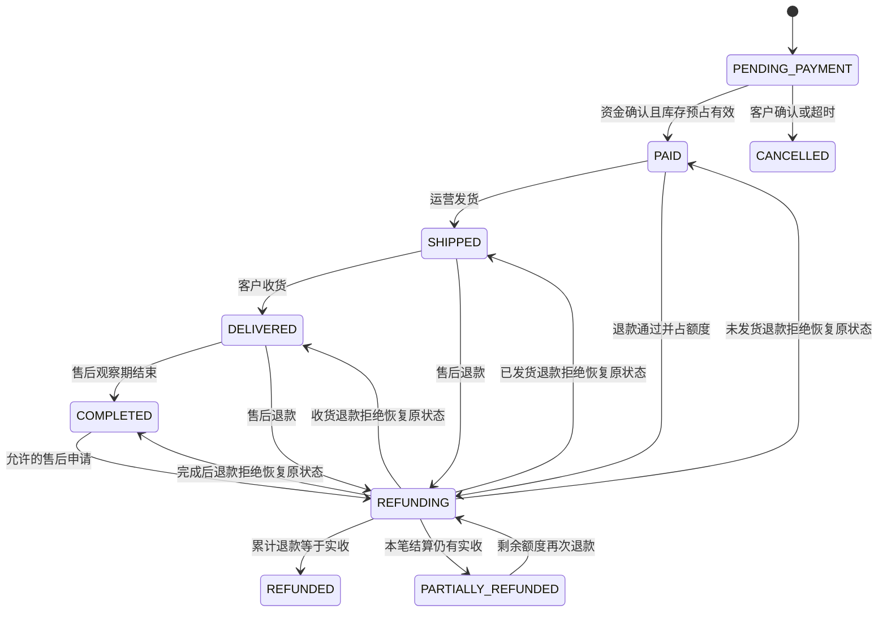

# 状态机与竞态规则

状态：M0 设计。所有迁移由映射表驱动，聚合 version CAS，失败409；history/event 与状态同事务。重复相同事件返回首次结果，不重复历史/分录。

完成后售后是为退款/奖励冲正留的显式路径，是否允许由规则期限检查；不增加未经验证的 AFTER_SALE 功能。部分退款保存原履约阶段，后续发货/收货/结转按原阶段推进，不能把 PARTIALLY_REFUNDED 当作已完结。

| 聚合 | from → to | 前置与副作用 |
|---|---|---|
| reservation | reserved→consumed | 支付确认；reserved 减、sold 增，一次 |
| reservation | reserved→released | 取消/超时；reserved 减、available 增，一次 |
| payment | created→pending→succeeded/failed/unknown | wallet 冻结/第三方请求；unknown 仅查证，不新键重付 |
| payment | created→succeeded | 纯钱包，资金/库存/订单同事务 |
| payment | succeeded→partially_refunded/refunded | 退款回执确认；累计不超实收 |
| refund | requested→approved/rejected | 客户确认/L2；运营审批或规则自动批准 |
| refund | approved→processing→settled/failed/unknown | 意图先提交；失败释放申请额度，unknown 保留额度 |
| refund | unknown→settled/failed | 原请求键查证，禁止盲重放 |
| topup | created→pending→succeeded/failed | 支付单与充值单金额/币种一致；一次 journal |
| reward | pending→review/paid/cancelled | 首单完成+已验证手机+延迟期+风控+限额 |
| reward | review→pending/cancelled | 权限人工复核，不直接让前端设 paid |
| reward | paid→reversed/receivable | 退款冲正；余额不足进入追偿，禁止负用户余额 |
| adjustment | pending→approved/rejected | 请求人≠批准人，两个权限+step-up；一次 journal |
| delivery | pending/retry→sent/retry/dead | 频控/静默/退避；唯一 notification/channel |
| session | active→consumed | refresh CAS 轮换，新行同 family |
| session family | active→revoked | old refresh 重放、注销、改密/禁用；所有 access sid 同样失效 |

## 必须消除的竞态

支付 vs 超时：二者先 CAS 同订单；支付赢才 consume，超时赢 release。晚到成功回调不能复活 CANCELLED；记录 late_payment，创建退款清算待处理，不拒绝记录已经收到的真实资金。

部分退款并发：申请时原子预留 refund_reserved_cents，总已退+预留≤实收；unknown 仍计预留。退款审核拒绝恢复 original_status，不能根据当前“已发货”猜测。

重复回调：先验签再检查业务和唯一 transaction_id；同流水同 body 返回已处理结果，同流水不同金额/币种记录冲突，不当作正常幂等成功。

refresh 并发：同 token 只有一个 CAS 成功，另一个按重放吊销 family；前端使用单飞避免误触；不通过缓存旧响应绕过重放检测。

奖励退款 vs 成熟：锁/CAS 奖励及来源订单，经 OrderService 获取最新状态；退款事件先取消 pending 或冲正 paid；唯一 journal business key 阻止重复发奖/撤回。

注销 vs 下单/资金变更：统一 account active check 和账户/订单锁；注销最终 CAS 停用后新请求不能提交写意图。
